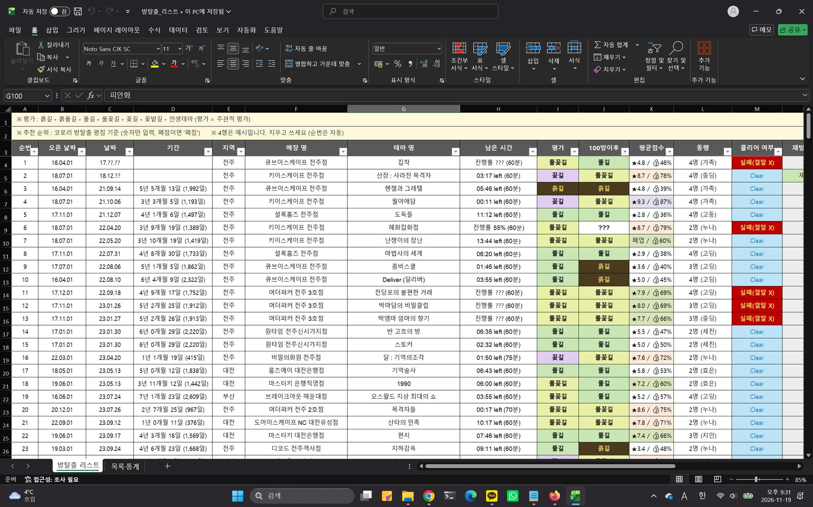
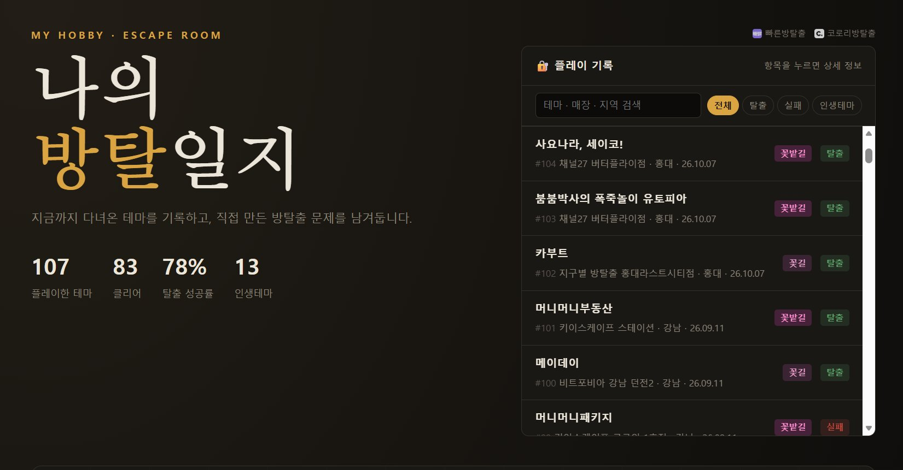
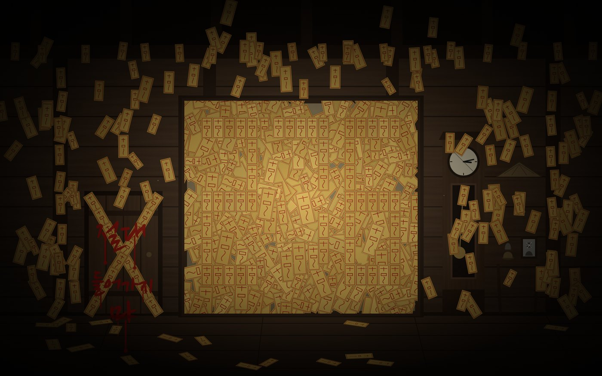
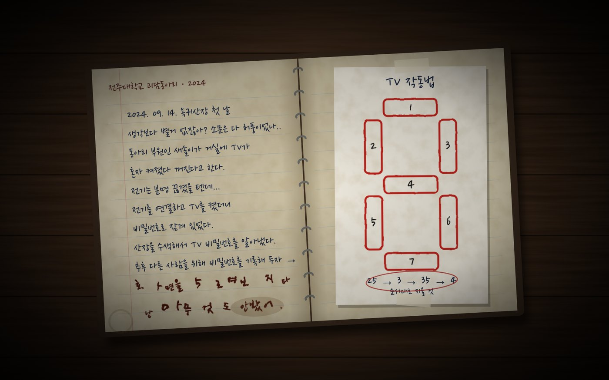

# 01 · 나의 방탈일지 · 미니 방탈출

> 방탈출 107개 테마를 직접 기록하고 분석한 데이터로, 웹 방탈출 게임까지 만들었습니다.

- **기간**: 2017 – 현재 (기록), 2026 (웹 페이지 · 게임 제작)
- **형태**: 개인 프로젝트
- **기술**: Excel, HTML / CSS / JavaScript

## 1. 플레이 데이터 기록

테마마다 날짜, 지역, 매장, 남은 시간, 내 평가, 커뮤니티 평점, 동행 인원, 클리어 여부를 엑셀로 기록했습니다.

| 지표 | 값 |
|---|---|
| 다녀온 테마 | 107개 |
| 탈출 성공률 | 78% (83개 클리어) |
| 연간 플레이 | 2023년 18개 → 2025년 28개 |
| 지역 | 10곳 (3분의 2는 전주 밖) |

기록을 웹 페이지로 옮겨 통계와 목록을 볼 수 있게 만들었습니다.

## 2. 직접 만든 미니 방탈출

괴담 동아리 설정의 웹 방탈출입니다. 제한시간 60분, 장면 이동, 효과음, 점프스케어 연출을 구현했습니다.

| | |
|---|---|
|  |  |
|  |  |

### 기획 포인트
- 단서 → 정답 → 다음 방으로 이어지는 흐름을 먼저 설계
- 막히는 지점을 위해 힌트 패널을 따로 둠
- 107개 테마를 하며 느낀 "좋은 테마의 조건"을 퍼즐 난이도와 연출 타이밍에 반영

## 실행 방법
`index.html`을 브라우저로 열면 됩니다.

> 테마 포스터 이미지는 각 방탈출 업체의 저작물이라 저장소에 올리지 않았습니다.
