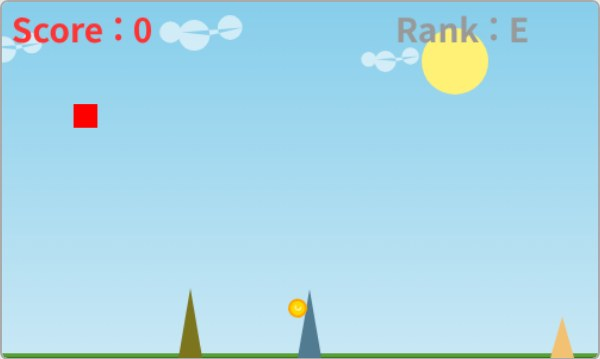

# 02 · Jumping Nemo

> 1학년 때 처음으로 직접 기획하고, LLM 없이 처음부터 코딩한 점프 미니게임입니다.

- **시기**: 2022 (1학년, 프로그래밍기초와실습 기말 프로젝트)
- **형태**: 개인 프로젝트
- **기술**: HTML5 Canvas, JavaScript

## 기획 의도
한 번 더 하고 싶어지는 게임. 쉬운 조작에 점점 빨라지는 속도와 랭크 보상을 더했습니다.

## 게임 시스템
- 클릭 · 탭으로 점프, 2단 점프
- 점수가 오를수록 장애물 속도 증가
- 코인 · 콤보 · 파티클 효과
- 랭크 9단계 (E → D → C → B → A → A+ → S → SS → SSS), 랭크마다 배경 테마 변경
- SPACE로 바로 재시작

## 실행 방법
`index.html`을 브라우저로 열면 바로 플레이할 수 있습니다.
