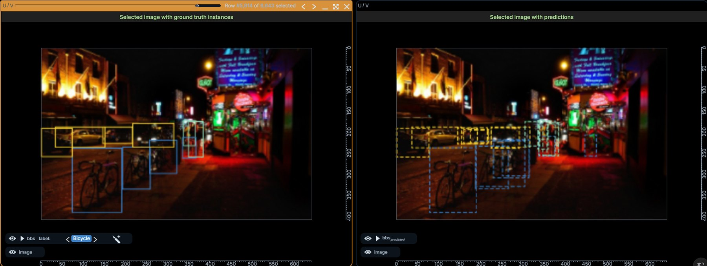
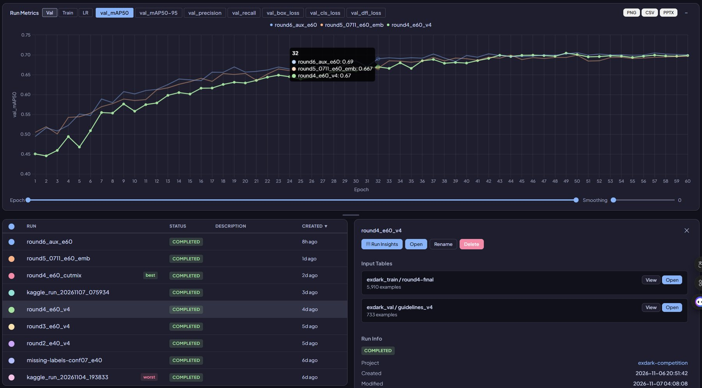
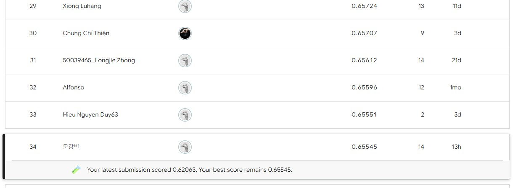

# 03 · 3LC 저조도 객체탐지 챌린지

> 모델은 고정, 바꿀 수 있는 건 데이터뿐. 라벨을 고쳐서 194팀 중 34위를 기록했습니다.

- **기간**: 2026.11 · 개인 · Kaggle 대회
- **기술**: YOLO11n(고정), 3LC 대시보드, Python
- **데이터**: ExDark 저조도 이미지 (학습 5,910장, 검증 733장)

## 무엇을 했나
3LC 대시보드에서 같은 사진의 정답 라벨과 모델 예측을 비교해, 빠지거나 틀린 라벨을 찾아 고쳤습니다.

1. **빠진 라벨 채우기**: 누락된 객체를 여러 라운드에 걸쳐 추가
2. **틀린 박스 고치기**: round8에서 위치가 어긋난 박스를 수정
3. **오탐 원인 분석**: 벤치 · 소파 · 스툴이 의자로 잡힘 → 보조 클래스 6개 추가 → 검증 데이터와 클래스 구성이 달라 학습 에러 → 보조 클래스 삭제로 정리
4. **학습 설정 비교**: 같은 데이터에서 CutMix 등 설정만 바꾼 런 9개 비교

## 결과
- 리더보드 **0.65545**, **194팀 중 34위** (상위 18%, 2026.11.19 기준) · 14회 제출

## 배운 점
로컬 검증 점수가 가장 높았던 런(mAP50 0.7136)이 리더보드에서는 오히려 낮았습니다. 검증 데이터와 실제 평가는 다를 수 있다는 걸 배웠고, 이후로는 여러 런을 함께 비교해 판단합니다.
