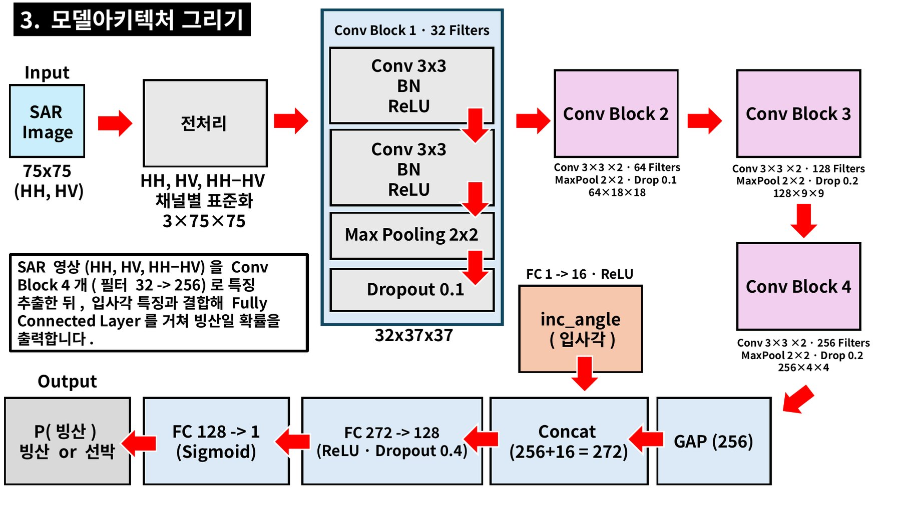
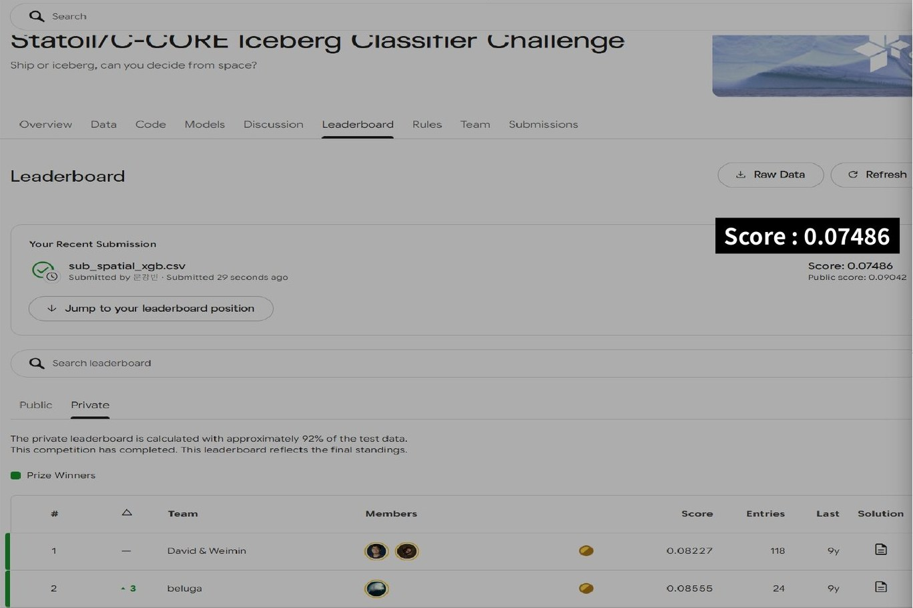

# 04 · 위성 영상 빙산 분류

> 과제 목표(0.1)를 넘긴 뒤에도 개선을 이어가 Log Loss를 0.178에서 0.0749까지 낮췄습니다.

- **기간**: 2026.10 · 개인 · 첨단신경망 과제 (Kaggle Statoil/C-CORE Iceberg Classifier Challenge)
- **기술**: PyTorch, timm (ResNet34, EfficientNet-B0, ConvNeXt-nano), XGBoost, 5-fold
- **평가**: Log Loss (낮을수록 좋음)

## 개선 과정

| 단계 | 방법 | Log Loss |
|---|---|---|
| 1 | 직접 설계한 CNN + 5-fold | 0.178 |
| 2 | 사전학습 ResNet34 블렌딩 | 0.151 |
| 3 | 모델 4종 스태킹 | 0.146 |
| 4 | pseudo-label 3라운드 | 0.139 |
| 5 | 입사각 정보 후처리 | 0.090 (목표 달성) |
| 6 | XGBoost 2단 스태킹 | 0.0838 |
| 7 | 공간 모델 결합 (최종) | **0.0749** |

## 어려웠던 점과 해결
- 학습 데이터가 적어 과적합이 심했고 0.139에서 점수가 멈춤
- 8방향 회전 · 반전 증강과 pseudo-label로 데이터를 늘리고, 상위 솔루션을 분석해 입사각 정보를 후처리에 활용

## 결과
최종 Private 점수 **0.07486**. 종료된 대회에 제출한 점수지만, 대회 당시 1위 점수(0.08227)보다 오차가 낮습니다.

📄 [제출 보고서](iceberg_report.pdf)
