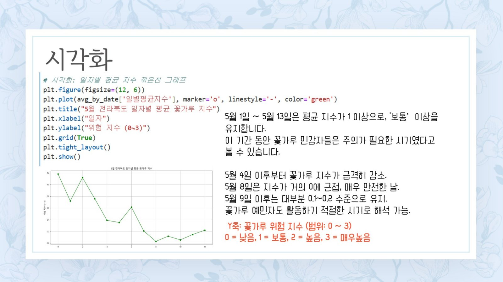
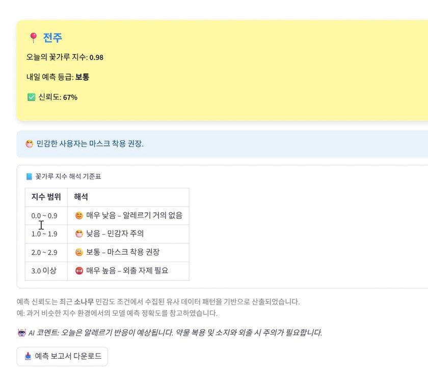

# 05 · 꽃가루 수치 예측 시스템

> 공공데이터로 지역별 꽃가루 위험을 알려주고 다음 날 등급을 예측하는 웹 서비스를 만들었습니다.

- **기간**: 2025.05.22 – 06.17 (약 41시간) · 개인 · 데이터분석기초 기말 프로젝트
- **기술**: Python, pandas, matplotlib, Streamlit
- **데이터**: 공공데이터포털 꽃가루농도 위험지수

## 왜 만들었나
미세먼지에 비해 꽃가루 정보는 찾기 어렵고 이해하기도 어렵다는 점에 주목했습니다.

## 무엇을 했나
1. **전처리**: 여러 CSV 병합, 문자열 분해, 날짜 변환
2. **등급화**: 지수 0–3을 낮음 · 보통 · 높음 · 매우높음으로 바꾸고 행동 가이드 연결
3. **분석**: 요일별 패턴, 연속 고위험일 분석

4. **예측**: 마르코프 체인으로 상태 간 전이 확률을 계산해 다음 날 등급과 신뢰도 예측
5. **서비스**: 지역과 민감한 꽃가루를 고르면 오늘 지수, 내일 등급, 행동 가이드를 보여주는 Streamlit 앱, 예측 보고서 다운로드

| 메인 화면 | 결과 화면 |
|---|---|
|  |  |

📓 [분석 노트북](pollen_forecast.ipynb) · 📄 [최종 발표](final_presentation.pdf)
