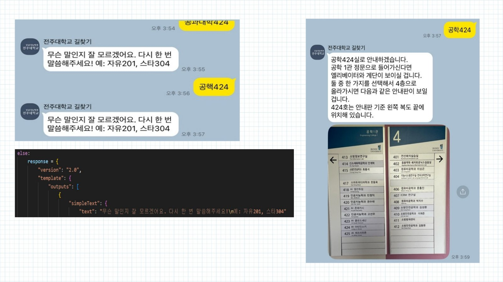
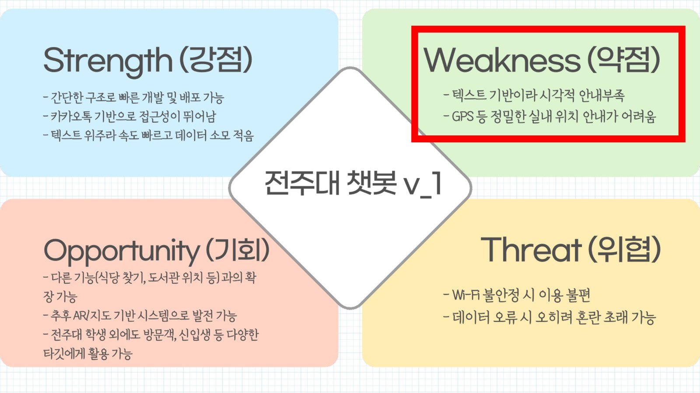
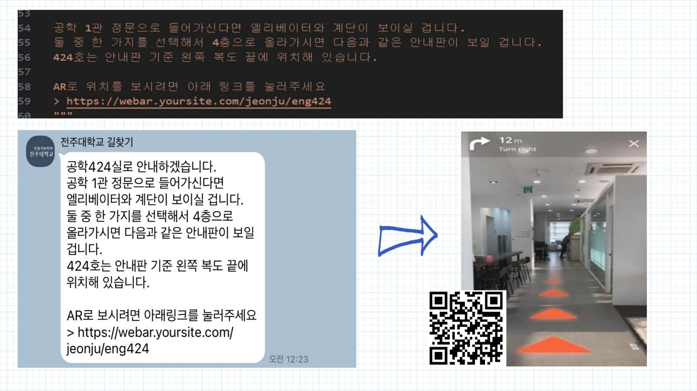

# 06 · 캠퍼스 길찾기 챗봇

> 학생들의 불편에서 출발해, 카카오톡 길찾기 챗봇을 만들고 AR 안내로 확장했습니다.

- **기간**: 2025 · 서비스러닝 팀 프로젝트 (6명)
- **내 역할**: [역할 입력]
- **기술**: Python, Flask, ngrok, 카카오톡 채널, Unity, Vuforia

## 진행 과정
1. **문제**: 설문으로 단과대학 · 강의실 찾기의 불편을 확인
2. **구현**: 익숙한 카카오톡 채널 + Flask 서버로 챗봇 구현. 개발 단계는 ngrok, 운영은 AWS로 나눠 판단
3. **개선**: SWOT 분석으로 텍스트 안내의 약점을 찾고, Unity · Vuforia AR 길 안내로 보완
4. **확장**: 말레이시아 UTM 캠퍼스용 다국어 챗봇 계획

| 챗봇 대화 | SWOT | AR 데모 |
|---|---|---|
|  |  |  |

📄 [최종 발표](final_presentation.pdf)
