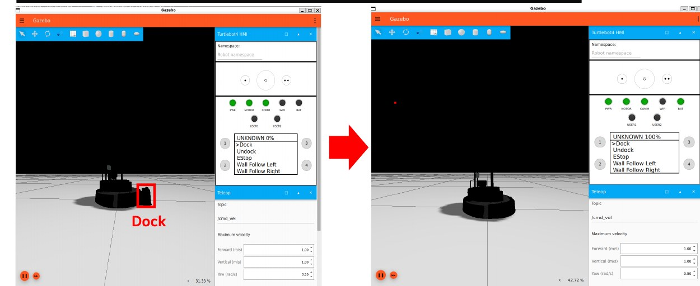
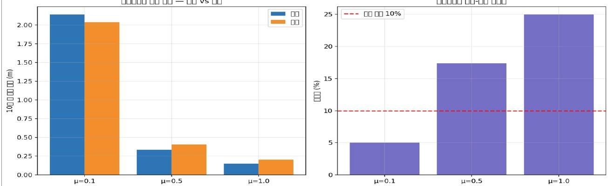
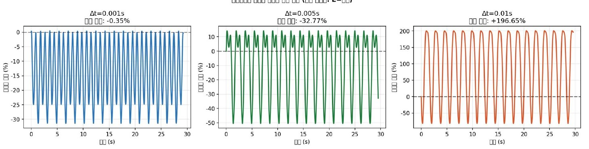
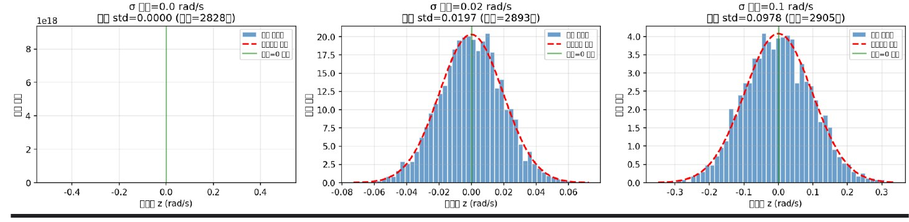

# 08 · ROS2 Gazebo 물리 시뮬레이션 실험

> 시뮬레이션에서 생긴 문제를 직접 찾아 고치고, 마찰 실험 오차를 92% 이상에서 5.0%로 줄였습니다.

- **기간**: 2026.06 · 개인 · 피지컬 AI 부트캠프 ND1 (M13 PBL)
- **기술**: ROS2, Ignition Gazebo, TurtleBot4, rosbag, ros_gz_bridge, Python, WSL2 Ubuntu

## 실험 1 · 마찰계수에 따른 미끄러짐 거리
1. **문제 발견**: 로봇이 전진하지 못하고 충돌 후 뒤로 밀려 −1.0m가 기록됨 → 정면의 Dock 모델이 원인임을 찾아 제거
2. **모터 잠금 해제**: 비상 정지(E-Stop) 인터락을 서비스 호출로 해제
3. **조건별 데이터 수집**: world 파일의 μ를 0.1 · 0.5 · 1.0으로 바꿔 가며 `/odom`을 rosbag으로 기록
4. **측정**: 속도 명령을 한 번만 주고, 이후 움직임은 물리 엔진에 맡겨 이론값과 비교




**결과**: μ=0.1에서 측정 2.141m · 이론 2.039m, 예시 데이터에서 92% 넘던 오차를 **5.0%**로 줄여 허용 기준(10%) 통과.
μ=0.5 · 1.0에 남은 17.4% · 25.0%는 바퀴 미끄러짐과 이산화 오차로 분석했습니다.

## 실험 2 · 타임스텝 안정성
Δt 0.001 · 0.005 · 0.01초에서 오차 **0.35% · 32.77% · 196.65%**.
첫 실행의 +10,051% 오차는 감쇠 0 설정과 녹화 시작 시점 때문으로 보고 다시 측정했습니다.



## 실험 3 · IMU 센서 노이즈
σ 0.02 · 0.1로 설정하고 약 2,800–2,900개 샘플을 모아 측정 표준편차 **0.0197 · 0.0978** (오차 1.7% · 2.2%)을 확인했습니다.



## 사용한 주요 명령어

```bash
# Gazebo + TurtleBot4 실행
ros2 launch turtlebot4_ignition_bringup turtlebot4_ignition.launch.py world:=worlds/friction_test

# 로봇 앞 Dock 모델 제거
ign service -s /world/friction_test/remove --reqtype ignition.msgs.Entity \
  --reptype ignition.msgs.Boolean --timeout 3000 --req 'name: "standard_dock" type: MODEL'

# 비상 정지 해제
ros2 service call /e_stop irobot_create_msgs/srv/EStop "{e_stop_on: false}"

# 조건별 데이터 기록
ros2 bag record -o results/friction_mu0.1 /odom

# 속도 명령 1회 발행
ros2 topic pub -1 /cmd_vel geometry_msgs/msg/Twist "{linear: {x: 2.0}}"

# 타임스텝 실험
ign gazebo worlds/pendulum_test.sdf
ros2 bag record -o results/pendulum_dt0.001 /joint_states /imu/data

# 분석
python3 scripts/exp1_friction.py
python3 scripts/exp2_timestep.py
```

📄 [M13 실험 보고서](M13_report.pdf)
