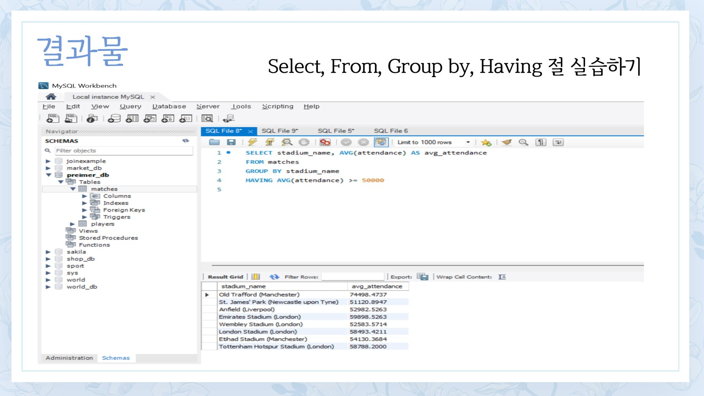
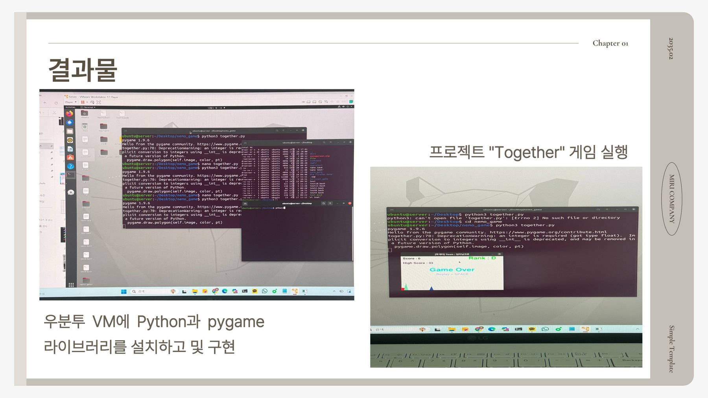

# 09 · 학습모임 운영 (팀장)

> 교내 "투게더" 전공심화 학습모임 두 개를 팀장으로 끝까지 이끌었습니다. (각 6명)

## 데이터베린이 · SQL
- 6회 동안 기초 문법부터 윈도우 함수, 모의고사 오답 분석, 가상 DB를 설계하는 미니 프로젝트까지 진행
- **역할**: 일정 총괄, 퀴즈 출제, 보고서 작성
- **기술**: MySQL, MySQL Workbench

## 딥러닝크루 · 리눅스 게임 제작
- 우분투 VM에서 pygame 점프 게임 "Together"를 완성. 점수 · 랭크 · 최고점 저장으로 반복 플레이 동기를 더함
- **역할**: 게임 기획, 기능 설계, 코드 통합
- **기술**: Ubuntu, Python, pygame

## 그 밖의 스터디
- 목이긴기린 · 유전 알고리즘 스터디 팀장 (TSP, 강의 시간표 최적화)
